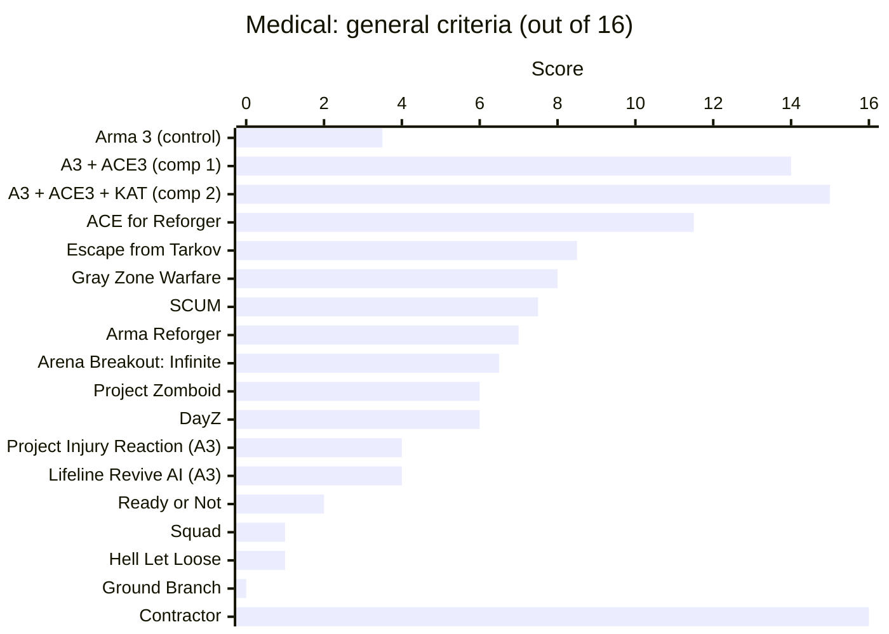
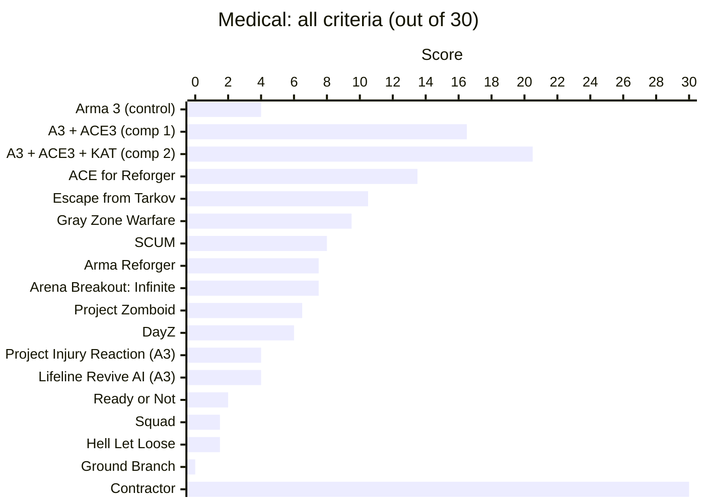

# Contractor: Features

Contractor is a near-future, first-person tactical shooter about a private military company.
You lead an 8-slot squad of contractors (up to 4 players, AI fills the rest) through a
persistent campaign: take contracts from a board, prepare at your base, deploy into large
generated zones, get the job done and get out alive. There are no hitpoints. Every soldier has
6 litres of blood, a body that is traced bullet by bullet, armour that chips voxel by voxel, and
a medical system deep enough that keeping your people alive is half the game. The world is built
from destructible voxels, gear is physical and visible on the body, and the AI fights,
treats casualties and scavenges by the same rules as the players.

This list covers what is built and in the game today (2026-10-12). Work still under way is in
"In progress" at the end.

---

## Squad and roles

- 8-slot squad: two fire teams of four (A and B), each with its own medic.
- Up to 4 players. AI fills every free slot (7 AI squadmates for a solo player, 4 for four players).
- Battle-buddy pairs within each fire team.
- Seven roles, each with its own starting kit: Team Leader, Medic, Autorifleman, Grenadier,
  Marksman, Rifleman and Anti-Tank.
- Anti-Tank: a Carl Gustaf (M3E1 MAAWS) 84 mm recoilless rifle with 2 HEAT and 1 HEDP rounds, plus an M4A1.
- Rifleman: carries 2 AT4 disposable launchers on top of the rifle kit.
- Team Leader: field radio (AN/PRC-152) and binoculars.
- Medic: the full medical load (see Medical), with an aid bag on the back of the pack.
- Grenadier: 4 frags and 3 smokes in grenade pouches.
- Marksman: M110 DMR, M17 sidearm and binoculars.
- Autorifleman: 10 rifle magazines.
- Every kit has an IFAK and a tourniquet in a holder on the carrier.
- Pick your role and your shooting hand (right or left) on the main menu. AI takes the remaining
  roles and keeps one medic in each fire team.
- Every AI soldier is a person: a surname on a name tape, a nationality, a shooting hand
  (11% left-handed) and a body type.
- Company hires are US, UK or Canadian. Enemies use regional names. No two name tapes in the company match.
- Male and female soldiers. Women appear at each nation's real-world service rates. Medics are at
  the national share, combat roles lower.
- HUD squad list: slot, fire team, role, colour team and what each squadmate is doing. It shows no health.

## Squad AI

- Each AI picks from scored intents every half second: follow, hold, move, patrol, investigate,
  fight, casualty care, reload, heal, scavenge and escort.
- Takes cover that actually blocks the threat. Prefers concrete and sandbags over wood or sheet
  metal that rounds go through.
- Crouches when not shooting and rises to fire bursts.
- Suppression: close rounds suppress. A pinned soldier stays down and holds fire.
- Pinned in the open, a squadmate crawls to cover within 6 m instead of freezing.
- Bounding overwatch: buddies never move at once. One calls "Moving!", the other "Covering!" and
  fires on the last known threat.
- Throws frags at enemies who stay hidden behind cover, only when the throwing arc is clear.
- Hearing: squadmates hear enemy shots within 200 m (suppressed 40 m) and turn toward the
  shooter. The guess gets less accurate with distance.
- Shared contact: what one squadmate sees reaches the others within 80 m.
- Friendly sight out to 120 m. Contact is remembered for 20 s.
- Halts: when the leader stops, squadmates take a spot beside something solid near their slot and watch outward.
- Never fires through a teammate or a civilian.
- Stays within a leash of the leader in a fight with no cover nearby.
- Ignores unconscious enemies, except a dead-check while clearing a position.
- Combat modes: Safe (weapons lowered, no fights started), Aware, Combat (default, crouch at
  halts), Stealth (always crouched, no sprint, fires only when fired on or at close range).
- Formations: wedge, file, line, staggered column.
- Command menu (F1-F8 per slot, ~ for everyone, Shift+F-key to add; number keys or mouse wheel):
  - Move: return to formation, move there, stop.
  - Target: focus fire on the enemy under your crosshair (up to 300 m), or clear the target.
  - Engage: open fire, hold fire.
  - Mount: get in that vehicle, get out.
  - Status: report status, report an enemy position by radio.
  - Action: throw smoke or frag there, scavenge that body, scavenge freely or don't scavenge,
    escort that HVT or stop escorting, fire launcher there.
  - Combat mode, Formation, Team (select fire team A or B, assign or select red, green, blue and yellow colour teams).
- Any player can give orders. The last one to give an order leads.
- Callouts as subtitles: contact with direction and distance, reloading, frag/smoke/flashbang
  out, moving, covering, man down, "Medic!", "Moving to X", "Treating X", "Need a medic on X",
  carrying, checking the body.
- Scavenging: out of contact, an AI that is short of something searches a nearby dead body one
  item at a time (a pouch takes 1.5 s, a pack 4 s, a plate swap 8 s).
  - Ammo first: only magazines its own weapon takes, up to its kit's basic load.
  - Then missing medical items, then grenades and smokes, then lost kit (a leader's radio). Intel is always taken.
  - Armour only when well out of contact, and only a clearly better plate that fits, or a helmet.
  - Takes another rifle only when its own has no rounds left anywhere.
  - Never goes past 35 kg of load, and never takes bulky items, spare carriers or packs.
  - One soldier per body. A dead player's body is never touched.
  - Contact stops it at once.
  - Enemies scavenge by the same rules.
- Casualty care: see Medical, "AI medics and casualty care".
- Roster skills (aim and nerve) set an AI squadmate's aim, reaction time and how firmly it keeps orders.
- Squadmates walk through each other, so doorways don't jam.
- Navigation updates around a breached wall within a fraction of a second.
- AI holds still while a briefing is open.

## Enemy forces

- Hostiles use the same body, wound model and AI as the squad: garrisons in buddy pairs, guards and patrols.
- A target site's garrison matches the contract's true enemy strength, even when the briefing understates it.
- Insurgents sometimes carry an RPG-7. They fire it at vehicles and at groups behind cover, never
  at a lone soldier in the open, and call "Backblast clear!"
- Hot-zone alert: the enemy knows only what its own people see, hear and radio in.
  - Reports take time, and a man killed first never reports.
  - The last known position grows less certain over time.
  - Areas move from normal to suspicious, alerted and engaged, then cool down slowly. There is no meter on screen.
- Pressure: the squad earns points from firefights, kills, blasts, wiped patrols, objectives and
  alarms. Points decay when it's quiet and are halved once the comms mast is down. Tiers come at 10, 20, 35 and 50.
- Enemy response by alert and pressure:
  - Roaming patrols check reports.
  - Patrols double and checkpoints close.
  - A QRF comes from the nearest QRF base. A second comes at tier 2, and none once every base is gone.
  - Hunter teams at tier 3 flank, track and use smoke.
  - The HQ reinforces its sites at tier 4.
- Nothing spawns in the squad's sight.
- Contract-zone reinforcement waves come in from the terrain edge at least 350 m out, sooner and
  bigger over time. There is no on-screen timer.
- Badly hurt, isolated hostiles may surrender (optional setting).
- Loot an enemy handheld radio to listen to their net until they change frequency.

## Medical

### Wound model

- No hitpoints. Hits make wounds on 14 body parts: head, face, neck, chest, abdomen, pelvis,
  both upper arms, forearms, thighs and shins.
- Every round is traced along its wound channel through the body. What it passes sets the wound:
  vessels, organs and bones.
- 29 named blood vessels are simulated: carotids, jugulars, subclavian arteries and veins, aorta, vena cava,
  pulmonary, renal, iliac, femoral artery and vein, popliteal, brachial, radial and ulnar.
- A vessel bleeds by how close the round passed. A direct hit bleeds fully, and a vessel inside
  the round's temporary cavity bleeds partly.
- Organs: brain, heart, left and right lung.
- Bones: femurs, tibias, humeri, forearms, hands, collarbones, pelvis and ribs. There is no spine, by design.
- Hits land on the body's real 0.5 cm voxel shape. A round between the legs or past a wrist flies
  on, and a channel runs as deep as the body is along its path.
- Separate hit shapes for male and female bodies.
- Round classes (pistol, intermediate rifle, full-power rifle, fragment, spall) set wound size,
  fracture odds, open-break odds and pain.

### Bleeding and blood volume

- 6 L of blood.
- From 15% lost: more sway, slower stamina recovery, slower movement.
- From 30% lost: no sprint.
- At 40% lost: unconscious.
- At 50% lost: cardiac arrest, with a 10-minute window.
- Bleeding types:
  - arterial: limb arteries, fixed with a tourniquet;
  - venous: limb veins, fixed with a pressure bandage;
  - junctional: neck, armpit and groin, fixed by packing with gauze;
  - internal: torso arteries and veins, fixed only with a surgical clamp (an IV buys time).
- Plus muscle wounds, grazes, chest-cavity bleeding and open-fracture bleeding.
- Bleeding follows the heart's output: less blood or a stopped heart pushes less out.
- A femoral artery hit takes about 2 to 3 minutes to knock you out.
- Blood never comes back on its own. Only an IV or IO line with a bag running restores it.
- Hypothermia: with 30% or more lost and lying still for 5 minutes, bleeding runs 25% faster until a blanket goes on.
- Blood loss greys and fades your vision, with tunnel vision from 30% lost.
- Visible wounds:
  - entry holes, and bigger exit holes;
  - voxel blood that soaks out, runs down the body, drips and pools on the ground;
  - spray thrown from an exit wound;
  - dressings that show once the wound is treated.

### Pain, consciousness and trauma

- Pain from 0 to 1 knocks you out when it holds at the threshold for 3 s. The threshold is 0.9 at
  full blood and drops to 0.6 at 30% lost.
- Wound pain fades over about 15 minutes, and impact pain over about 5.
- An untreated fracture keeps pain at a set minimum until it is splinted.
- Consciousness follows the body. There is no revive. You stay out while any cause holds:
  - low SpO2;
  - pain at the threshold;
  - 40% of your blood lost;
  - cardiac arrest;
  - a concussion knockout;
  - morphine sedation;
  - total trauma.
- Total trauma: too many serious wounds at once keep you out, even with blood left.
- You come round on your own 10 to 20 s after the last cause clears.
- While unconscious you see a black screen with UNCONSCIOUS or a cardiac-arrest countdown.

### Airway and breathing

- An unconscious casualty's airway can block, and an NPA prevents or clears it. A spell out of
  under 45 s clears the airway on its own.
- Each lung has its own efficiency, reduced by collapse (pneumothorax) and by blood in it (hemothorax).
- An unsealed chest wound collapses its lung by 40%. Once sealed, the lung re-expands over 2 minutes.
- A bleeding chest wound fills that side's lung with blood, and the blood stays there.
- Tension pneumothorax: an unsealed chest wound has a 50% chance to develop one after 60 to 120 s.
  It collapses that lung, squeezes the other, and stops the heart about 90 s later. The
  decompression needle relieves it.
- SpO2 (hidden) follows the lungs, blood loss, the airway and morphine:
  - under 85: unconscious;
  - about 2 minutes under 70: the heart stops.
- Breathing rate (hidden) rises as the lungs fail or blood is lost, and falls with too much morphine.
- Signs you can check:
  - breathing fast, slow or laboured;
  - blue lips;
  - no breath sounds on one side;
  - trachea shifted and neck veins bulging.

### Heart and cardiac arrest

- Heart rate (hidden) is 75 bpm at rest. Blood loss and pain raise it. Morphine and very low SpO2
  lower it. It sinks toward 40 bpm as blood loss nears 50%.
- Over 200 bpm or under 35 bpm for a minute stops the heart.
- A heart hit causes cardiac arrest within 2 to 6 s.
- Pulse signs: racing, fast and weak, slow, no pulse.
- Cardiac arrest gives a 10-minute window.
- CPR (10 s cycles, no item needed) and the defibrillator (5 s shock, not used up) restart a heart
  only once blood is back above 60%. Each CPR cycle has an 8% chance and each shock 35%, plus 15% with epinephrine.

### Head injuries

- A bullet to the head past the helmet is fatal.
- A fragment into the brain (through the face) knocks you out at once. It is fatal 60% of the
  time (cardiac arrest 20 to 60 s later). Otherwise you stay unconscious until you're back at base.
- Concussion comes from helmet stops (10%, 40% or 80% chance by round class) and from blasts. It
  can knock you out for 5 to 20 s, then blurs your vision, adds sway and slows turning for 60 s.
- A full-power rifle round stopped by a helmet within 200 m can still kill, rarely.

### Bones and fractures

- Chance a hit bone breaks: pistol 25%, intermediate rifle 70%, full-power rifle 95%, fragment 20%.
- Open and closed breaks:
  - A bullet or fragment break is open by a chance set by round class (higher for a femur).
  - A fall's break is mostly closed.
  - An open break bleeds and needs a dressing as well as a splint.
- Moving fast on an unsplinted broken leg can turn a closed break open, and it worsens a femur's internal bleed.
- Broken leg: walk only, no sprint. A splint lets you jog, but you can't sprint until the mission ends.
- Broken arm: heavy sway and reloads 1.6 times slower. A splint steadies it.
- Broken hand: counts as a broken arm.
- Broken collarbone: more rifle sway and slower aiming down sights. Pistols are unaffected. A splint (as a sling) eases it.
- Broken pelvis: heavy internal bleeding. You can't stand or walk (crawl, or be carried) but can
  still shoot. A pelvic binder cuts the bleed and the pain. The legs stay out until the mission ends.
- Ribs: a plate stop can crack a rib, but only at close range (for 5.56: 20% at point blank, none
  past 100 m). So can a bullet through an unplated chest. A cracked rib costs stamina.

### Blasts, burns, falls and hearing

- Blast overpressure within 5 m (10 m indoors): ears ring for 20 to 60 s, a concussion check, bruising.
- Blast lung within 3 m (6 m indoors):
  - It costs SpO2 and stamina, then holds steady while the casualty rests.
  - Sprinting, jumping, heavy loads or IV fluid the body doesn't need make it worse.
  - It eases over about 20 minutes of rest. Exertion can also collapse a lung.
- Burns within 2 m of a blast:
  - Pain scales with the share of the body burned.
  - Over 20% burned, the body loses fluid as if bleeding.
  - Each burn dressing eases pain for about 10% of the body.
- Falls:
  - Under 3 m: no injury.
  - 3 to 6 m: leg pain and a 30 to 70% chance of a broken leg (sometimes the pelvis).
  - Above 6 m: increasingly fatal, 90% from 10 m.
- Deafness from blasts, flashbangs (3 to 6 s) and sustained gunfire indoors (30 s after about ten
  close shots). Electronic ear protection blocks flashbang and gunfire deafness and halves blast deafness.
- Armour stops still hurt: impact pain, stagger, getting winded, cracked ribs. Plates alone never
  knock out a healthy soldier, but they can knock out one who has lost blood.
- Being run over by a vehicle is blunt trauma through the wound model.

### Treatments and items

- Tourniquet (4 s, 6 s on yourself):
  - It goes on high and tight and stops all bleeding on that limb below it.
  - It adds pain, and on a leg forces a limp.
  - A rushed one (under 2 s, or under fire) only stops 70% of the bleeding. A second tourniquet fixes that.
  - Up to 2 per limb. Packing the wound with gauze lets you take the tourniquet off.
- Pressure bandage (5 s): venous, muscle and graze wounds.
- Hemostatic gauze (8 s): packs junctional bleeds.
- Vented chest seal (5 s): stops a tension pneumothorax from starting.
- Splint (8 s): legs, arms and collarbones.
- Pelvic binder: for a broken pelvis.
- NPA airway (3 s).
- Decompression needle (5 s): relieves a tension pneumothorax at once.
- Morphine autoinjector (2 s):
  - Morphine is a level in the blood. A dose absorbs over 30 s and halves every 12 minutes.
  - Two doses are fine, three sedate, and five or more slow breathing dangerously.
  - It shows as pinpoint pupils.
- Epinephrine (2 s): +30 bpm, better restart odds in arrest, and a 50% chance to wake someone kept out only by a concussion.
- Atropine (2 s) raises a slow heart. Adenosine (2 s) slows a racing one.
- Pulse oximeter: Check condition reads SpO2 and pulse as numbers.
- Defibrillator and CPR.
- Burn dressing (5 s) and hypothermia blanket (5 s).
- Every treatment has its own hand animation, which everyone sees. Examples:
  - bandages wrapped round the limb;
  - gauze packed in;
  - a tourniquet windlass turned;
  - the needle in at the second intercostal space;
  - CPR compressions at about 110 a minute;
  - defibrillator pads on and hands clear.
- Moving away, going down, or the casualty being moved interrupts a treatment without using up the item.

### IV, IO, fluids and blood

- IV catheters in 10, 12, 14, 16, 18 and 20 gauge:
  - flow runs from 5x down to 0.6x the 18-gauge rate;
  - placing one takes from 22 s down to 8 s;
  - bigger bores hurt more and are rarer.
- An IV goes in either forearm or either lower leg, never below a tourniquet.
- You can't put a line in yourself, but you can hang a bag on your own line.
- IO kit: a sternal line in 5 s that always works.
- Saline and blood bags of 250, 500 and 1000 mL. One runs at a time, taking about 2.75, 4.5 or 7.5 minutes through an 18 gauge.
- A pressure bag doubles the flow.
- Shock:
  - From 25% lost, IVs take longer to place (up to twice as long) and can miss, up to 60% of the
    time at 50% lost. A miss uses up the catheter.
  - From 37% lost the veins collapse and an IV runs at half rate. IO is then the better choice.

### Surgery

- Surgery kits with 2, 3 or 5 uses (common, uncommon, rare). Each use is a hemostat clamp of about 20 s, for players and medics only.
- The clamp is the only fix for internal torso bleeding, and it also closes junctional and arterial bleeds.
- It can close a chest wound instead of a seal. A clamped chest has a 10% chance to reopen each
  time the casualty sprints, jumps or sets off under a heavy load.

### Kits

- IFAK: 1 tourniquet, 2 pressure bandages, 1 hemostatic gauze, 1 vented chest seal.
- Trauma kit: 2 tourniquets, 4 bandages, 2 gauze, 2 chest seals, 1 splint, 2 morphine, 1 NPA.
- Loose items are used before kit contents. The inventory shows what's left in each kit.
- Every carrier has a tourniquet holder with a visible tourniquet, plus one in the IFAK.
- Medic's aid bag: worn on the back of the pack, holds 12 L of medical gear, medics only.
- The medic's load includes:
  - tourniquets, gauze, bandages, chest seals, splints and a pelvic binder;
  - morphine and NPAs;
  - 18 and 14 gauge IVs, 2 IO kits, 2 saline bags, a blood bag and a pressure bag;
  - decompression needles and a pulse oximeter;
  - epinephrine, atropine and adenosine, and a defibrillator;
  - a 3-use surgery kit, burn dressings and a blanket.

### Medical menu, checks and HUD

- Medical menu (H) opens on the person you look at within reach, preferring the living, or on yourself:
  - a clickable body diagram of the 14 parts, coloured by state (bleeding by severity, untreated, treated);
  - markers for tourniquets, splints, dressings, seals and IV/IO lines;
  - the chosen part's injuries in words;
  - every medical item you carry, greyed out with the reason when it can't be used there now;
  - signs in words (numbers only with a pulse oximeter);
  - an activity log.
- Triage cards in the medical menu: none, minimal (green), delayed (yellow), immediate (red),
  expectant (black). Cards show in Check condition, and the AI respects them.
- Quick-treat (Shift+H): applies the next item you carry to your most urgent wound.
- Body interaction points (Left Ctrl):
  - points on a squadmate's head, chest, each arm and each leg, each with that part's check and treatments;
  - a general point at the waist;
  - the same points on yourself with Left Ctrl + Left Alt.
- The Treat list follows casualty-care order and names the body part ("Tourniquet, left thigh").
- Check condition gives plain signs. Examples:
  - unresponsive, laboured breathing, blue lips;
  - pulse racing, fast and weak, slow or absent;
  - coughing blood, shivering and cold skin;
  - burns over about N% of the body, ears ringing;
  - clamped wounds and the line and bag in place.
- HUD body silhouette in the corner while you have an untreated bleed, a fracture or a tourniquet.
- Screen effects: greying and fading from blood loss, tunnel vision, blur from concussion, flashbang white-out.

### AI medics and casualty care

- Who answers: the casualty's fire-team medic, then their battle buddy, then the other medic,
  then the nearest free squadmate.
- Medics put the wounded first, even in a firefight:
  - smoke between a casualty in the open and the threat;
  - a drag to cover;
  - a tourniquet while still exposed.
- They fight back only at close range while the rest of the squad covers them.
- Care order in cover:
  - massive bleeding, airway, decompression needle, chest seal;
  - bandages and gauze, then a line and bags;
  - splints, then morphine for a conscious casualty in pain.
- In cardiac arrest: line and bags, epinephrine, shocks and CPR for the whole 10-minute window.
  Adenosine or atropine follows for a heart rate out of range.
- A medic tries an IV up to 4 times before handing the casualty to someone else.
- Triage cards set the order: immediate first, then delayed and uncarded, then minimal, and expectant last.
- A wounded HVT in the squad's hands is a priority casualty.
- Wounded AI tourniquet their own arterial bleeds at once, treat the rest in cover, and call "Medic!" for the rest.
- Squadmates without an item call for a medic who has it.
- After treatment they guard an unconscious casualty, or carry them with the squad until the casualty wakes; they never lift or drag away someone another soldier is treating.
- Dead friendlies are carried after the squad leader once out of contact.
- Back at base, broken bones, burns, blast lung and heavy blood loss mean days out of action. The medbay shortens that for money.

## Armour and ballistics

- Plates and helmets are 1 cm voxel objects that are both what you see and what gets hit. Each round is traced voxel by voxel.
- A stopped round leaves a dent. Repeated hits on one spot wear through: about 5 hits for steel,
  3 for polyethylene and helmets. A round that gets through leaves a hole.
- Every hit wears down integrity by round class and the piece's durability. A 5.56 round takes
  about a quarter of a PE plate, 18% of a ceramic one and 8% of a steel one.
- Helmets lose 30%, 23% or 18% per hit (bump, ballistic, assault).
- Below 30% integrity, steel and polyethylene start letting rounds through. At zero they stop nothing.
- Ceramic cracks in zones round each hit. Hits near cracks get through more often, and enough hits shatter the plate.
- Rounds and armour share one rating ladder, from IIA to IV. Armour stops what it is rated for and nothing above it.
- Plates: polyethylene III (light), steel III++ (medium), ceramic IV (heavy), and steel side
  plates. Each plate fits only the right carrier.
- Carriers:
  - low-profile: 3 L, front plate;
  - plate carrier: 6 L, front and back plates;
  - assault carrier: 8 L, front, back and two side plates, with a collar and groin flap.
- Helmets:
  - bump: light, open face;
  - ballistic: NVG shroud and rails;
  - assault: ear covers and a visor that stops rounds to the face.
- Only the assault helmet stops rifle rounds, up to M855 and 7.62x51 ball.
- Carriers are soft armour that stops pistol rounds and fragments where they cover, even after the plate fails.
- Steel plates throw spall, which is rare and minor, at the neck, face and arms. The medium
  carrier's collar covers the neck, and the heavy carrier covers neck, face and arms.
- Plates sit inside fabric pockets on the carrier. Torn cover shows the damaged plate underneath.
- Carriers are fitted to the wearer's body, male or female.
- Damage belongs to the item. A dropped plate keeps its holes, armour lying on the ground can be
  shot, and saves keep all of it.
- Rounds lose energy with range. A distant M855 can be stopped by a light plate.
- Wood and sheet metal can be shot through, and whoever is behind takes a round with less energy.
  Thick stacks of wood stop it. Concrete stops all small arms.

## Weapons, grenades and launchers

### Firearms

- M4A1 carbine (semi/auto, 750 rpm), Mk18 CQBR (semi/auto, 800 rpm), M110 DMR (semi), M17 pistol.
- Magazines: 5.56 (30), 7.62 (20), 9 mm (17). Loose 5.56, 7.62x51 and 9 mm rounds.
- Load magazines from loose rounds at 5 rounds a second. Moving or firing stops it.
- Reload (R) takes the fullest magazine, mag pouches first. A part-used magazine goes back into the pouch.
- Reload times are per weapon (pistol 1.6 s, M110 2.8 s), and slower with a broken arm.
- Fire selector (F), remembered per weapon.
- Aiming down sights: zoom per weapon, spread cut to 12% of hip fire, half recoil, slower movement.
- Spread widens on the move (up to 2.5x) and in the air. It tightens crouched and prone.
- Recoil kicks the view up and to the side.
- Rest the weapon (C) on a wall, sill or the ground for half the sway and recoil until you move.
- Sway grows with pain, blood loss, concussion and fractures.
- Left- and right-handed shooters: shoulder, hands, sling, holster, draw and first-person view are all mirrored.
- Realistic holds: stock in the shoulder, bladed stance, both hands on the weapon, rifle slung
  across the carrier, pistol drawn from the holster.
- First-person arms and hands on the weapon.
- The minimal HUD has no ammo counter. Weight, litres, rounds loaded and armour state are on the inventory screen.

### Grenades and charges

- Frag grenade:
  - 3 to 8 fragment wounds on exposed body parts. Walls, bodies and armour shield.
  - Overpressure, and craters in voxel walls.
- Flashbang: white-out for up to 5 s by distance and facing. It stuns AI and deafens anyone close.
- Smoke: white, green, yellow, blue and purple. A 5 m cloud lasts 30 s and blocks sight for players and AI.
- Shift+G switches grenade type. The AI only throws when the arc is clear.
- Breaching charge:
  - hold it up as a ghost on any surface within 2.5 m, then place it;
  - it sticks to the world, a person or a vehicle and rides along with them;
  - after a 10 s fuse it blasts and carves a breach;
  - it destroys a raid target within 1 m.

### Anti-armour launchers

- A separate launcher slot (key 3).
- AT4 (M136) 84 mm: disposable HEAT.
- Carl Gustaf (M3E1 MAAWS) 84 mm: reloadable, with HEAT, HE and HEDP rounds.
- SMAW (Mk153) 83 mm: HEDP and thermobaric rounds.
- NLAW: disposable. Fires overfly top attack or direct attack, with a soft launch.
- Javelin: command launch unit and missile. Hold the seeker on a vehicle for 2.5 s to lock. Top or direct attack, soft launch.
- RPG-7: PG-7V HEAT and OG-7V fragmentation rockets. Enemy weapon, loot and sell only.
- Sights with range marks for the loaded round. F switches attack mode.
- Rounds fly as real projectiles with motors, drop, an arming distance and self-destruct. Every player sees them.
- Warheads:
  - shaped charges penetrate armour by millimetres, and the jet kills whoever is in line inside;
  - HE and HEDP blow craters in walls, while HEAT bores a narrow hole;
  - thermobaric rounds clear rooms;
  - fragments and overpressure wound through the wound model;
  - a direct hit on a person is lethal.
- Backblast:
  - a cone behind the tube, lethal close in and injuring further out;
  - a wall or vehicle right behind reflects it onto the shooter, and a small room fills with it;
  - you can't fire from a vehicle seat.
- Disposable launchers ride on top of the pack (1 on the assault pack, up to 3 on the ruck) and come off onto the shoulder.

## Vehicles

- 14 voxel vehicle models at 5 cm: UH-60M Black Hawk, AH-1Z Viper, AAV-7A1, MaxxPro, M-ATV, M2A3 Bradley, M1 Abrams, and seven technicals.
- Drivable ground vehicles with full physics and suspension. Wheeled vehicles steer with the front wheels and tracked ones skid-steer.
- Seats per model:
  - M-ATV: 4 plus gunner;
  - MaxxPro: 6 plus gunner;
  - technical: cab, bed and gunner;
  - AAV-7: 3 crew plus 21 troops;
  - Bradley: 3 crew plus 6;
  - Abrams: 4.
- Get in, switch seats and get out through action points on doors, ramp, cargo and service panels.
- Load a downed or dead body into a seat and pull it out again.
- Mounted guns: .50 M2 on the MRAPs and DShK on the technical, fed belts from the vehicle's cargo. The gunner fires them.
- Cargo inventory with litre and kg limits.
- Fuel, empty tanks and jerrycans.
- Hit zones: hull, engine, wheels or tracks, fuel, crew and cargo, with armour by class.
- Penetration by class:
  - small arms bounce off armoured vehicles;
  - 7.62x54R and up penetrate MRAPs;
  - a technical's doors stop nothing;
  - IFVs and tanks stop .50 on most faces.
- A round that gets through carries on into the people inside.
- Engine hits slow then stop a vehicle, wheel and track hits cripple it, and fuel hits leak and can start a fire.
- Hits carve holes and scorch into the vehicle's own voxel hull.
- A burning vehicle kills anyone who stays aboard and destroys its cargo. It becomes a wreck that can be salvaged for parts.
- Field repairs, each timed: repair kit, spare wheel, track links, engine parts, battery.
- AI drivers follow the navmesh, with recovery when stuck.
- Vehicles push soldiers aside and wake bodies lying ahead. Running someone over causes blunt trauma.
- Vehicles and wrecks are saved with the zone.
- Engine sound per vehicle class, rising with speed.
- Helicopters have models, seats, cargo and damage. They aren't flyable yet.

## Inventory and gear

- Space is measured in litres and weight in kg. Pockets hold 2 L, and the carrier and pack add more.
- Slots: primary, sidearm, launcher, helmet, carrier, backpack and four plate pockets.
- Carried weight slows you, and a full load doubles the time to start and stop.
- Bulky items (cases, crates) take both hands and block sprinting and firing.
- Pickups stow themselves into the right pouch first (magazines, grenades, medical items).
- Items keep their state wherever they go: rounds loaded, armour damage, what's left in a kit.
- Inventory screen (Tab):
  - a live 3D preview of your soldier that you can turn;
  - equipment slots, container grids, and a panel for the ground within reach;
  - item tiles rendered from each item's own voxel model.
- Drag and drop between slots, pouches, containers, the soldier and the ground. Right-click a tile
  for its actions, or double-click for the first action.
- MOLLE attach points on carriers: 6 (light), 9 (medium), 12 (heavy). Point types: mag, pistol mag,
  knife, radio, medical, utility, tourniquet and chest.
- Attachables:
  - single and double M4 mag pouches and a double pistol mag pouch;
  - radio, binocular, GP utility, sustainment, IFAK and grenade pouches;
  - a tourniquet holder and a fixed-blade knife.
- MOLLE view:
  - attach points laid out with lines to where they sit;
  - free points that fit the selected pouch light up;
  - a refusal says why (no carrier, no point of that type, or all taken).
- Attachments stay on the carrier when it's dropped, looted, stowed or saved.
- Packs: Assault Pack (24 L) and Ruck (45 L). They carry disposable launchers on top and the medic's aid bag on the back.
- A stowed pouch or carrier takes up the space its contents fill.
- Gear is visible on the body:
  - pouches on their points, a tourniquet in its holder, IFAK pull tabs;
  - the name tape, the slung rifle, pack straps, launchers on the pack.
- Utility items:
  - AN/PRC-152 field radio and enemy handheld radio;
  - binoculars, electronic ear protection, zip cuffs.
- Give a stowed item to a squadmate.
- Player respawn kit: M4, 2 spare magazines and 90 loose rounds, a smoke and a frag.

## Movement and stances

- Walk, jog and sprint (stamina, about 15 s from full, less under load), and jump.
- Movement with weight: about 0.2 s to stop and 0.3 s to reach a jog, with momentum into turns and a moment of sway after a hard stop.
- Crouch (X) and prone (Z).
- Caps Lock + W/S steps through three standing heights, three crouching heights and prone.
- Caps Lock + A/D for side stances. When prone, it rolls you onto a side.
- Lean (Q/E): hold to lean, double-tap to stay, tap to come back. Leaning stops short of walls.
- Hitboxes follow the pose, so crouched and prone soldiers are smaller targets.
- No sprinting or jumping while crouched or prone, and no sprinting under a roof too low to stand.
- Step up onto bodies and over piles up to 0.75 m.
- Injuries change how you move: a broken leg means walking only, a leg tourniquet means a limp, and a broken pelvis means crawling.
- Ragdolls: downed and dead bodies fall and lie with real joint limits. A body comes back up where its ragdoll lay.
- Knees bend: kneeling puts the back knee on the ground, and legs fold as they swing.

## Interaction

- Hold Left Ctrl for action points on items, bodies, squadmates, people and vehicles within about 3 m.
  Move the cursor onto one and let go to choose it.
- Left Ctrl + Left Alt for actions on yourself.
- Carrying and dragging:
  - fireman's carry at 55% speed;
  - drag at 35%: you face the casualty and back away with S;
  - Release or Put down, or press G to let go.
- Looting:
  - Loot (one item) or Loot all (whatever fits);
  - includes what's on a carrier's MOLLE pouches;
  - a carrier taken with Loot all hands its contents over separately, so they land in your own pouches.
- Check condition, check your own wounds, give item, pick up.
- People: lead, stop, send to cover, search, carry, zip-cuff.
- "Radio for a contract" from your own menu when the squad has a field radio.
- Animations for carry, drag, pick up, equip, stow, drop, weapon draw, treating and looting. Every player sees them, including late joiners.
- Every dead player, squadmate and enemy leaves a body with all their gear.
  - Up to 12 bodies are kept, and older ones leave their gear where they lay.
  - Bodies are saved with the zone.
- A dead player's gear stays at their body under a floating marker.

## World

- Destructible voxel structures at 10 cm. Bullets, frags, charges and launchers carve holes, craters and breaches.
- Materials behave differently:
  - wood and sheet metal take round-sized holes and break out after 10 or 16 rounds;
  - concrete takes crack marks;
  - sandbags, HESCO and 18 regional building materials are in.
- Damage is shared with every player and saved.
- Contract zones are seeded terrain of 2 to 4 km², with hills, haze and distant terrain at lower detail.
- Hot zones are 16 km², with an enemy HQ, a comms site, 1 or 2 QRF bases, outposts, road
  checkpoints, villages and patrol routes.
- Hand-built modules on the terrain:
  - compound, HESCO outpost with bunker and watchtower, village of four houses, road checkpoint;
  - AA emplacement, weapons caches, enemy HQ, QRF base and radio mast.
- Modules load in full detail within 260 m and unload past 340 m. Stand-ins show them out to 2.5 km.
- Terrain presets: temperate, coastal lowland (with sea along one side), salt flats, desert wadi
  (carved riverbeds), rocky ridge and scrubland. A zone's name or region picks its preset.
- Seeded scatter of rocks, scrub and trees. Large rocks and trees block movement and shots.
- Navigation bakes in the background around players and AI in a fight.
- Zone persistence:
  - looted and dropped items, voxel damage, bodies and vehicles;
  - each zone comes back the same on every visit;
  - saves are written safely, with a backup.
- Civilians follow daily routines, flee and hide from gunfire, cower, and shout as they run.
- Voxel soldiers built at 0.5 cm: low-poly with faces, separate male and female bodies.
- Camouflage by faction: multi-terrain, woodland, desert and urban patterns.
- Civilians, hostages and HVTs wear plain clothes chosen by region and role.

## Missions, contracts and campaign

- Contract board:
  - generated from a seed, and always offers one low-risk job;
  - fixers offer special jobs once your reputation is high enough;
  - you can hold up to 4 contracts, and letting one lapse costs reputation.
- Negotiation:
  - trade off pay, salvage share, support budget and an advance (30%);
  - renegotiate or abort once the real threat shows.
- Difficulty runs from 1 to 5 and can understate the threat, more often when intel is poor.
- Clawback terms per contract: the advance is kept, prorated or returned on a void.
- Mission types:
  - Raid: destroy a weapons cache or an AA gun.
  - HVT capture: take a hostile HVT alive to extraction within 90 minutes.
  - Hostage rescue: bring a hostage out within 75 minutes.
  - Intel grab: carry out a laptop or a hard case.
  - Each type has a bonus objective.
- Timed objectives show the minutes left on the HUD.
- HVTs:
  - hostile ones try to expose the squad and run;
  - an uncuffed captive may bolt when left unwatched, but cuffed ones never do;
  - escorts lead him, run him down and grab him if he bolts.
- Intel items (laptop, phone, documents) count once carried out. Enemy positions reported by radio count at once.
- Civilian casualties caused by the squad cost fines, and the 8th voids the contracts.
- Recovery contracts for squadmates left behind alive (MIA). They wait where they were left.
- Briefing on the map:
  - contract, objectives and what intel knows of the enemy (estimates are never exact);
  - plan marks, insertion point and ready-up.
- Map (M):
  - grid references, zoom and pan, your squad's positions;
  - shared markers and lines, intel enemy positions, objectives and extraction points.
- Extraction:
  - at a landing zone, a grid reference or purple smoke;
  - everyone needed is inside, the host confirms, and a 10 s countdown runs;
  - then a report of who and what got out.
- Debrief:
  - pay and bonuses, civilian fines;
  - salvage picks and what was carried out;
  - casualties, reputation, intel turned in or sold.
- Economy:
  - one bank with a ledger and a campaign clock in days;
  - weekly wages and base upkeep;
  - emergency and manual loans;
  - reputation with each faction.
- Base hub (FOB), walkable:
  - armory stash, motor pool, medbay, hiring board and shop terminal;
  - prep before deploying: kit up, pick the squad and roles, buy supplies.
- Roster of persistent people:
  - name, role, skills (aim, nerve, medical, movement), experience and a wage that grows with them;
  - their own gear, history and injuries.
- Rotating hiring pool with sign-on fees. There is no fixed starting squad.
- Death rules:
  - AI death is permanent. A squadmate left behind alive goes MIA.
  - Players respawn in the default kit.
  - Free respawns per deployment: 4 in a contract zone, 8 in a hot zone.
  - After that each respawn costs more ($1,000, $1,500, $2,000 and so on), paid from cash first, then the support budget.
- Factions: Meridian Logistics, Black Ridge Militia, Coastal Salvage Union. Reputation tiers run from hostile to allied.
- Escape menu: Resume, Return to Base (revert to just before deploying), Return to main menu, Quit.

## Sound

- Sounds are generated in code and stylised to fit the game. A real recording can replace any of them.
- Gunshots near and far (rifle, pistol, suppressed), and the crack of rounds passing close.
- Impacts on dirt, plate and body. Explosions near and far, flashbangs, reloads and throws.
- Footsteps, harder on structures and vehicles and quieter crouched; none from soldiers standing still or in the air (jumping, falling), and of everyone around you only the three nearest walking are heard, so a squad never sounds like a crowd.
  - Steps only sound while actually walking.
  - Of other soldiers, only the 3 nearest are heard.
  - Each soldier's stride starts at its own point, so a squad doesn't step in unison.
- Vehicle engines per class, rising with speed.
- Each player hears from their own position, delayed by distance at the speed of sound.
- Hearing ranges match the AI's: what you hear, they hear.
- Reverb under a roof. Deafness muffles everything.
- Callouts have a voice channel ready for recorded lines. They show as subtitles today.

## Multiplayer and co-op

- Co-op for up to 4 players on a listen server. The host is authoritative.
- Host or join from the main menu or the command line (UDP port 24680). Joining retries automatically.
- Late joiners see everything: voxel damage, smoke at its current age, bodies, carried bodies, markers and rounds in flight.
- Clients send requests and the host checks each one. Bad input is refused before anything is spent.
- Your role and shooting hand go to the host when you join.
- Joining players follow the host into the base or the zone.

## Debugging and dev tools

- Session logs: every playtest writes a numbered session (P0001...).
  - It records errors, warnings, slow frames, network events, zone changes and every message shown to the player.
  - Downs and deaths are logged with cause, body part, attacker and range.
  - Every treatment is logged.
  - The folder ends PASS or FAIL.
- The first time each kind of issue happens, the session saves a state dump and a screenshot.
- Bug-report key (Insert, any build):
  - type a note;
  - saves the note, zone and seed, every soldier's state and AI intent, your inventory and wounds, the last log lines and a screenshot.
- AI overlay (Delete, dev tools):
  - labels over AI within 80 m with intent, status, target, combat mode and suppression;
  - a line to where each AI is heading.
- Dev tools (editor, debug builds or `--dev`):
  - K hurts yourself;
  - Shift+End extracts at once;
  - End opens the contract board;
  - Page Up shows the hot-zone enemy readout;
  - Page Down skips the enemy clock 5 minutes.
- The pause menu shows the session number to quote in a playtest report.
- Target dummies show condition, blood, bleed rate, pain and wound types.
- Test runs are numbered (R0001...) and dated, with PASS or FAIL. They are never deleted.
- 25 automated test suites run on every push. A suite only passes on a clean, complete run, and hangs are caught.
- A sound export tool writes every generated sound as WAV files.

## Test builds

- One script makes a playable test build: a small game pack, a launcher, and a BUILD.txt with the commit and what to test.
- Each build includes a "dev tools" launcher that starts with the dev keys on.
- Main menu entries:
  - Play (host), the test contract (briefing and extraction), Join;
  - Contract board (offline), Campaign at the base;
  - the 2 km test zone, the vehicle range, Reset compound save;
  - a toggle for civilians, HVTs and intel.
- Test sessions spawn players in their role's kit with a tidy row of spares, and the test contract starts fresh each time.

---

## Medical system compared

Our medical depth against tactical shooters, milsim games and milsim mods, scored on 30 criteria
(Y = 1, partial = 0.5). Vanilla Arma 3 is the control; Arma 3 + ACE3 is comp 1 and Arma 3 +
ACE3 + KAT is comp 2. Full table, sources and doubtful cells:
[docs/medical_market_comparison.md](docs/medical_market_comparison.md).

**General criteria (1 to 16)**: per-limb damage, bleeding, tourniquets, blood and fluids,
pain, fractures, unconsciousness, cardiac arrest and CPR, airway, drag and carry, AI medics,
AI self-treatment, triage, field surgery, drug dosing, lasting injuries. This is the fairer
comparison.

**All 30 criteria**: the general 16 plus 14 of our own distinct features (voxel wound
channels, bleed type decides the fix, per-lung chest injuries, brain fragments, blast lung,
AI never lifting someone under treatment, and so on). We score full marks on those 14 because
they were picked from our feature list, so read this chart with that in mind.

| | General /16 | All /30 | vs control | vs ACE3 | vs ACE3 + KAT |
|---|---|---|---|---|---|
| Arma 3 (control) | 3.5 | 4 | 0 | -12.5 | -16.5 |
| A3 + ACE3 (comp 1) | 14 | 16.5 | +12.5 | 0 | -4 |
| A3 + ACE3 + KAT (comp 2) | 15 | 20.5 | +16.5 | +4 | 0 |
| **Contractor** | **16** | **30** | **+26** | **+13.5** | **+9.5** |

Where we don't lead yet: on the general criteria ACE3 + KAT is one point behind us. Our body
doesn't compensate for blood loss (a faster heart doesn't change circulation), lost blood
never comes back without an IV, and bleeds don't clot on their own.

---

## In progress

Being built now, not in test builds yet:

- Backpack swap and roll-up.
- Radio on the front-left or front-right carrier spots.
- Gear fit fixes.
- Gear movement: bags and armour sway with the body.
- Carry and drag animations and transitions.
- Expanded command menu:
  - take cover and fall back;
  - stance;
  - suppress, including a generic suppress order;
  - casualty orders, heal up and rearm;
  - bounding;
  - garrison and clear;
  - drop packs and launcher out.
- Smarter AI tactics with a situational tactical evaluator.
- A spotting model where camouflage, stance, movement and distance matter.
- Fuller hearing and shared contacts (basic versions are in; see Squad AI).
- Morale.
- Faction doctrine.
- Roster skill (aim and nerve already shape AI aim, reaction and discipline).
